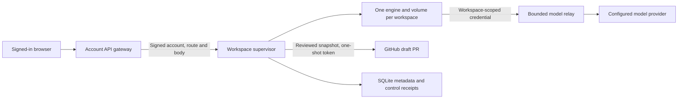

# Cloud workspaces pilot

This implementation starts from main `4299d743` on the isolated `cloud-workspaces` branch. It adds `/workspaces`, an authenticated account gateway, a separate workspace supervisor and persistent container workspaces. It has local validation; it is not a deployed cloud service or a published desktop release. Other feature branches, Codium sales and plan entitlements are not prerequisites for this pilot.

## Product behavior

A pilot account can create a workspace from a GitHub repository, start a saved chat, approve a requested action and continue the same workspace from another browser. The page polls for updates every five seconds while visible and every twenty seconds while hidden. Each workspace keeps its repository, engine database and chat history on its own volume. Pause retains those files. Start reconnects to the saved engine data; a paused workspace must be started to read its full chat history. Delete removes the workspace and its data.

Public repositories need no clone token. A private repository needs an explicitly supplied GitHub token with access to that repository. The clone token exists temporarily in the initializer's private `/run` tmpfs and is removed after checkout; it is not stored in workspace metadata.

To publish code, first pause and review the exported diff. Publication takes another read-only snapshot and requires the same digest. A separately supplied, one-shot GitHub token stays in the supervisor and never reaches the engine or its tools. The server creates a deterministic workspace branch and a **draft pull request**. It does not force-push or merge. The first pilot supports one published snapshot per workspace; the saved receipt reconciles a retry whose reply was lost. Further changes after publication require continuing the existing pull request outside this publication action or creating another workspace. A changed original base branch is refused rather than overwritten.

## Architecture and authority



- `api/cloud-workspaces.ts` and its library authenticate browser or existing CLI account tokens, check account revocation, require persistent rate limiting and enforce the pilot account allowlist. The browser cannot select a supervisor URL, engine address, host filesystem path or account identity.
- `signing.ts` binds the verified account, HTTP method, fixed route, timestamp, nonce and body hash with HMAC. The supervisor persists used nonces and rejects replay. The account token is not forwarded to the supervisor or container.
- `store.ts` uses SQLite WAL, prepared queries and immediate transactions. Ownership predicates protect account reads and writes. Creating/running quotas, total workspace quotas, account-scoped creation idempotency, revision CAS and model-call reservations survive restart. Public workspace metadata omits the engine password, runtime identity, idempotency key, call count, original commit and owner identity.
- `docker.ts` selects only managed containers and volumes with matching labels, image and resource configuration. Containers use UID/GID 10001, a read-only root, no added capabilities, no new privileges, finite memory/CPU/PID limits, bounded logs and private temporary files. Engine ports bind to host loopback. The Docker socket and host directories are not mounted in tenant containers.
- `worker/entry.mjs` embeds the existing Node engine through `Server.listen`, as desktop does. The gateway authenticates the account and the engine requires a workspace-scoped server password. This does not change or relax the standalone CLI's account gate. A long-lived account token and the primary provider key are never injected into the engine.
- `service.ts` owns lifecycle changes, the model relay, publication receipts and account-close fences. Model calls use the configured provider/model only, with the primary key retained on the supervisor. Engine routes exposed to the browser are a finite session, message, status, model and approval API, rather than an arbitrary engine proxy.
- The read-only exporter compares files against the original checkout commit, without running repository hooks, filters or diff drivers. Publication is limited to at most 100 changed text files, 4 MiB of changed content and a 256 KiB diff. Unsafe paths and changed symlinks or unsupported binary content are refused.

## Pilot limits and recovery

| Limit                                         | Default                             |
| --------------------------------------------- | ----------------------------------- |
| Creating/running workspaces per account       | 2                                   |
| Total retained workspaces per account         | 10                                  |
| Model requests over a workspace's lifetime    | 50                                  |
| Maximum output tokens per model request       | 4,096                               |
| Running lifetime per explicit Start           | 120 minutes                         |
| Container CPU, memory, disk and PID allowance | 2 CPUs, 4,096 MiB, 10 GiB, 512 PIDs |
| Reaper interval                               | 20 seconds                          |

The model counter does not reset on pause, Start or supervisor restart. These are request and resource limits, not a metered dollar budget or a billing integration. The stored `runningSince` boundary does not move when a model request updates workspace activity. Model admission checks that boundary directly, and the reaper retires expired engines.

Pause blocks new model admission before stopping the engine. Unknown model outcomes persist a block; they are not silently retried against the provider. After a supervisor restart, active engines are blocked and their retirement is attempted before the service starts listening. The user must explicitly Start and send a new turn. A separate durable pending-retirement record denies engine POSTs and model admission until the old engine is confirmed stopped, so a new prompt cannot clear that quarantine; failed retirement retains the active quota and is retried by the reaper, including creating workspaces. Private `message-identities.ts` storage allocates the engine's canonical chronological message IDs from stable client request UUIDs, bounded to 500 allocations per workspace. A durable payload hash rejects changed content under the same ID, retries do not dispatch the same turn twice, and the host confirms the saved user row before acknowledging delivery. This avoids the legacy engine loop's reliance on user/assistant ID ordering without trusting random browser-generated engine IDs.

Account deletion first records a durable closed-account fence. It immediately refuses further workspace access and model admission, cancels active publication where possible, and queues container/data cleanup. The reaper retries unfinished cleanup. Deleting workspace data also removes its model guard and local publication receipt. A GitHub request already sent may have completed; deterministic branch/PR checks reconcile uncertain publication replies without force-pushing. Existing GitHub pull requests are not deleted by workspace or account deletion.

On the website, account deletion is Codium's staged deletion (`api/_lib/codium-erase.ts`, WP A57). After it revokes the account's tokens, which already refuses the gateway, its first erase part, `workspaces`, sends the signed `/accounts/close` to the host. A deployment never given a workspace host (neither `VECTOR_WORKSPACES_ORIGIN` nor `VECTOR_WORKSPACES_SECRET`) skips the part; a partial setting, an unreachable host or a refused close fails it. A failed part is handled like every other part: the deletion answers pending, the tombstone records `workspaces`, the account's own Codium records and the identity wait, and the cleanup cron retries it with a backoff and alerts the owner after repeated failures. The close is repeated on every retry and on the follow-up pass after the identity is gone; the host answers `closed` again for an account it already fenced. Inside a deletion the part waits for the host only until the deletion's deadline.

## Operator setup

Use `packages/cloud-workspaces/.env.example` as a variable reference. Configure gateway variables on the account API deployment and runtime variables on the dedicated Linux supervisor host. Store real keys through the deployment's secret mechanism; none belongs in public website environment variables or the repository.

1. Provision a dedicated Docker host with `runsc` and a volume driver that actually enforces the configured disk quota. Verify quota exhaustion and recovery on that driver. The default local volume driver is refused in production.
2. Create a dedicated custom Docker network and enforce tenant/host/network segmentation outside this package. Engine loopback publishing and a custom network name do not themselves provide that policy. Tenant traffic must reach the scoped model relay through the Docker host gateway, while tenant access to other tenants, host services and infrastructure credentials remains denied.
3. Prepare and build the reviewed source engine image below. Configure `VECTOR_WORKSPACES_IMAGE` using its immutable digest or image ID; mutable tags are refused by the runtime.
4. Put the supervisor behind a TLS endpoint for the account gateway. The supervisor also listens on a host address reachable by its containers for the scoped relay. Restrict ingress with the host firewall/proxy; do not expose tenant engine ports. Give the gateway and supervisor the same newly generated HMAC secret, at least 32 characters long.
5. Configure the supervisor's fixed OpenAI-compatible model origin, model ID and provider key. Keep that primary key on the supervisor. Configure the persistent metadata directory and resource limits; the total workspace limit must be at least the active limit.
6. Keep `VECTOR_WORKSPACES_ENABLED=false` initially. Configure the existing account authentication, revocation and persistent abuse-limit services on the gateway, then set the exact comma-separated pilot account UUIDs. Enable only after operator validation and deployment review.

The gateway requires `VECTOR_WORKSPACES_ORIGIN`, `VECTOR_WORKSPACES_SECRET`, `VECTOR_WORKSPACES_ENABLED` and `VECTOR_WORKSPACES_ACCOUNTS`, plus the repository's existing Supabase/account and persistent Redis rate-limit configuration. Account deletion continues contacting a configured workspace host even after the pilot switch is turned off; retain its cleanup configuration until outstanding workspace data is retired.

The supervisor reads `NODE_ENV`, `HOST`, `PORT` and these `VECTOR_WORKSPACES_` variables:

| Variable suffix                  | Meaning/default                                                            |
| -------------------------------- | -------------------------------------------------------------------------- |
| `DATA`                           | Persistent SQLite directory; default `./data`                              |
| `SECRET`                         | Required shared signing secret                                             |
| `IMAGE`                          | Required immutable engine image                                            |
| `NETWORK`                        | Required dedicated custom Docker network                                   |
| `RUNTIME`                        | `runsc`                                                                    |
| `VOLUME_DRIVER`                  | Required production quota driver                                           |
| `VOLUME_SIZE_OPTION`             | Driver option name, default `size`; value is disk allowance in bytes       |
| `RELAY_ORIGIN`                   | Container-visible relay origin; default `http://host.docker.internal:4097` |
| `MODEL` / `MODEL_NAME`           | Required model ID / optional display name                                  |
| `MODEL_ORIGIN` / `MODEL_KEY`     | Required model API base URL and supervisor-only key                        |
| `MAX_ACTIVE` / `MAX_TOTAL`       | 2 / 10                                                                     |
| `MAX_MODEL_CALLS` / `MAX_OUTPUT` | 50 / 4,096                                                                 |
| `MAX_RUN_MINUTES`                | 120                                                                        |
| `DEV_UNSAFE`                     | Explicit non-production fixture escape hatch; leave unset in production    |

The current Docker adapter expects the container-visible relay at `http://host.docker.internal:<port>`. HTTPS is required for the separately configured public gateway-to-supervisor origin. The host's account API signing secret, provider key and persistent SQLite directory require backups/access controls appropriate to private workspace data. Volume backup, restore, capacity and retention policy are operator responsibilities.

### Host startup and TLS ingress

A dedicated Ubuntu 24.04 Linux host is a suitable pilot starting point, with capacity for both 4 GiB engines plus the supervisor/OS, a compatible `runsc`, and a verified quota driver. Run one supervisor process for its metadata directory and Docker host; the lifecycle leases are process-local. The following templates are unvalidated production setup examples, not infrastructure provisioning or deployment approval.

Install the reviewed source and pinned dependencies at `/opt/vector/source`, Bun at `/opt/vector/bin/bun`, and create a dedicated `vector-workspaces` service account. Give only that supervisor access to the rootful Docker socket; Docker-group membership grants powerful host control. Store the supervisor environment in root-owned `/etc/vector/cloud-workspaces.env` with mode `0600`. Create `/var/lib/vector/cloud-workspaces` owned by the service account with mode `0700`. A minimal `/etc/systemd/system/vector-workspaces.service` is:

```ini
[Unit]
Description=Vector cloud workspace supervisor
After=network-online.target docker.service
Requires=docker.service

[Service]
Type=simple
User=vector-workspaces
Group=vector-workspaces
SupplementaryGroups=docker
WorkingDirectory=/opt/vector/source/packages/cloud-workspaces
EnvironmentFile=/etc/vector/cloud-workspaces.env
ExecStart=/opt/vector/bin/bun src/main.ts
Restart=on-failure
RestartSec=5
TimeoutStopSec=150
UMask=0077
NoNewPrivileges=true

[Install]
WantedBy=multi-user.target
```

Keep the pilot disabled while validating this host. After the operator's deployment review, load/start the unit with `systemctl daemon-reload` and `systemctl enable --now vector-workspaces`. Inspect `systemctl status vector-workspaces` and its journal for startup/configuration errors. A supervisor restart deliberately pauses the old engines as described above.

A Caddy TLS proxy can expose only the signed control routes. Replace the example hostname and configure its DNS/certificate access before using this template:

```caddyfile
workspaces.example.com {
    @control path /workspaces /workspaces/* /accounts/close
    handle @control {
        reverse_proxy 127.0.0.1:4097
    }
    handle {
        respond 404
    }
}
```

Set the gateway's `VECTOR_WORKSPACES_ORIGIN=https://workspaces.example.com`; keep the supervisor's relay origin at `http://host.docker.internal:4097`. Bind the supervisor so that its Docker bridge can reach that port, but deny direct Internet access to `4097` with the host/network policy. The public proxy intentionally exposes no `/model/` route. Validate that an unsigned HTTPS `/workspaces` request receives `401`, the scoped relay works from a tenant engine, other tenant/host destinations remain blocked, and the gateway remains disabled until the full pilot sign-in/cleanup checks are approved. A TLS response alone does not validate production isolation.

## Build and validation commands

The following commands are local/CI procedures, not a deployment. Run package tests from their package directories. Bun 1.3.14, Node 24, installed pinned workspace dependencies and a Linux Docker host are the relevant runtime inputs.

```sh
# From packages/cloud-workspaces:
bun test test --timeout 30000
bun typecheck

# From test:
bun test cloud-workspaces-api.test.ts cloud-workspaces-node.test.ts account-delete-api.test.ts account-delete.test.ts site-publication.test.ts --timeout 30000

# From packages/web:
bun test src/lib/cloud-workspaces-client.test.ts --timeout 30000
bun typecheck
```

Prepare a new build-context directory from the repository root:

```sh
bun packages/cloud-workspaces/script/prepare-engine.ts /tmp/vector-cloud-engine-context --preview
docker build --file packages/cloud-workspaces/container/engine.Dockerfile \
  --tag vector-cloud-engine-fixture --iidfile /tmp/vector-cloud-engine.id \
  /tmp/vector-cloud-engine-context
VECTOR_WORKSPACES_TEST_IMAGE="$(cat /tmp/vector-cloud-engine.id)" \
  bun packages/cloud-workspaces/script/runtime-smoke.ts
```

`prepare-engine.ts` compiles the existing desktop Node engine, copies its runtime assets and pinned dependencies, and writes source/catalog/bundle identities to `CONTAINER-INFO.json`. Production preparation requires a clean, reviewed checkout and omits `--preview`. The development runtime smoke explicitly uses `runc` and local storage; it creates isolated fixture resources and removes them afterward. It runs a scripted, zero-cost provider, exercises the real write tool, exports the paused diff and verifies saved chat/files after engine restart. It makes no real model-provider call or GitHub publication.

To exercise the production-built page, first build and serve its local assets:

```sh
# From the repository root:
bun --cwd packages/web build
node script/prune-vector-site.mjs
node packages/cloud-workspaces/script/serve-preview.mjs
```

In a second terminal, install the browser fixture if necessary and run it:

```sh
# Install from packages/cloud-workspaces:
bunx playwright install --with-deps chromium

# Run from the repository root:
VECTOR_WORKSPACES_TEST_URL=http://127.0.0.1:3457 \
  bun packages/cloud-workspaces/script/browser-smoke.ts
```

The browser script opens independent desktop/mobile browser contexts against the actual page and intercepts account/workspace responses. Its fixture covers history continuity, follow-up, Allow once, pause/review, digest-bound publication controls, responsive layout, disabled/unavailable service and signed-out gating. It does not authenticate a production account or create hosted compute or a real pull request.

`.github/workflows/vector-workspaces.yml` adds a dedicated read-only-permission CI lane for package/API/client tests, typechecks, the production website, browser fixture and actual Docker engine smoke. The local validation does not establish a completed hosted run; retain the eventual workflow URL, source SHA and artifacts separately.

## Evidence scope and remaining external gates

After formatting, the cloud package suite passed **67 tests / 590 assertions**, the API/Node/account-deletion/site-pruning group passed **38 tests / 289 assertions**, and the browser client contracts passed **18 tests / 67 assertions**. Package and website typechecks pass. The [validation record](./evidence/cloud-workspaces-validation.json) holds the final source scope and completion status of each check, including the production website build and browser rerun. The [runtime receipt](./evidence/cloud-workspaces-runtime.json) scopes the actual Node engine smoke: two scripted-provider model calls, one real write-tool action and three saved messages; fixture changes additionally cover text edits, additions, deletion, executable mode, a missing final newline and hostile Git configuration that was not executed, with identical chat and files after restart. The [browser receipt](./evidence/cloud-workspaces-browser.json) records the production-page fixture's checks and intercepted backend scope. These receipts do not establish real provider inference, live publication or a deployed service, and counts from different suites are not evidence of a larger combined live trial.

No production service, cloud account infrastructure, real provider inference, live GitHub publication or production `runsc`/quota-driver isolation was validated by those checks. The remaining operator gates are:

- provision and validate the dedicated host, quota driver, network policy, image distribution, TLS ingress, private data backups and cleanup under infrastructure failures;
- configure production account/abuse services and the closed pilot allowlist, with approval for the actual deployment;
- validate real sign-in and cross-device continuation against that deployment;
- test an explicitly authorized repository/token publication to GitHub and reconcile its actual draft PR;
- validate the selected real model endpoint and its operational spending controls under an approved inference budget;
- complete the dedicated hosted CI run and retain its source-bound evidence.

These are external validation/deployment steps. This document does not enable the gateway, connect production credentials, publish a site or authorize a deployment.
