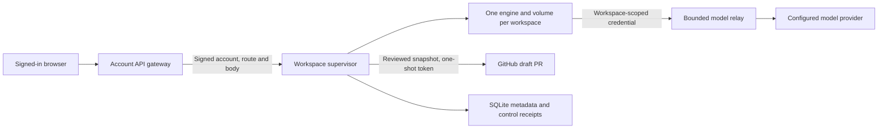

# Cloud workspaces pilot

This implementation was built on the isolated `cloud-workspaces` branch from main `4299d743` and is merged with the `v2` integration branch. It adds `/workspaces`, an authenticated account gateway, a separate workspace supervisor and persistent container workspaces. It has local and hosted CI validation; it is not a deployed cloud service or a published desktop release. Its one dependency on another feature is account deletion, which on `v2` is Codium's staged deletion (WP A57, below). Codium sales and plan entitlements are not prerequisites for this pilot.

The pilot is off by default. Until the gateway answers `enabled` for an account, the account page shows no cloud workspaces section and its deletion copy does not mention them. The production site build still publishes `/workspaces`, and before sign-in that page says the pilot is private and not open to everyone yet.

## Product behavior

A pilot account can create a workspace from a GitHub repository, start a saved chat, approve a requested action and continue the same workspace from another browser. The page polls for updates every five seconds while visible and every twenty seconds while hidden. Each workspace keeps its repository, engine database and chat history on its own volume. Pause retains those files. Start reconnects to the saved engine data; a paused workspace must be started to read its full chat history. Delete removes the workspace and its data.

Public repositories need no clone token. A private repository needs an explicitly supplied GitHub token with access to that repository. The clone token exists temporarily in the initializer's private `/run` tmpfs and is removed after checkout; it is not stored in workspace metadata.

To publish code, first pause and review the exported diff. Publication takes another read-only snapshot and requires the same digest. A separately supplied, one-shot GitHub token stays in the supervisor and never reaches the engine or its tools. The server creates a deterministic workspace branch and a **draft pull request**. It does not force-push or merge. The first pilot supports one published snapshot per workspace; the saved receipt reconciles a retry whose reply was lost. Further changes after publication require continuing the existing pull request outside this publication action or creating another workspace. A changed original base branch is refused rather than overwritten.

## Architecture and authority



- `api/cloud-workspaces.ts` and its library authenticate browser or existing CLI account tokens, check account revocation, require persistent rate limiting and enforce the pilot account allowlist. The browser cannot select a supervisor URL, engine address, host filesystem path or account identity.
- `signing.ts` binds the verified account, HTTP method, fixed route, timestamp, nonce and body hash with HMAC. The supervisor persists used nonces and rejects replay. The account token is not forwarded to the supervisor or container.
- `store.ts` uses SQLite WAL, prepared queries and immediate transactions. Ownership predicates protect account reads and writes. Creating/running quotas, total workspace quotas, account-scoped creation idempotency, revision CAS and model-call reservations survive restart. Public workspace metadata omits the engine password, runtime identity, idempotency key, call count, original commit and owner identity.
- `docker.ts` selects only managed containers and volumes with matching labels, image and resource configuration. Containers use UID/GID 10001, a read-only root, no added capabilities, no new privileges, finite memory/CPU/PID limits, bounded logs and private temporary files. Engine ports bind to host loopback. The Docker socket and host directories are not mounted in tenant containers.
- `worker/entry.mjs` embeds the existing Node engine through `Server.listen`, as desktop does. The gateway authenticates the account and the engine requires a workspace-scoped server password. This does not change or relax the standalone CLI's account gate. A long-lived account token and the primary provider key are never injected into the engine.
- `service.ts` owns lifecycle changes, the model relay, publication receipts and account-close fences. Model calls use the configured provider/model only, with the primary key retained on the supervisor. Engine routes exposed to the browser are a finite session, message, status, model and approval API, rather than an arbitrary engine proxy.
- The read-only exporter compares files against the original checkout commit, without running repository hooks, filters or diff drivers. Publication is limited to at most 100 changed text files, 4 MiB of changed content and a 256 KiB diff. Unsafe paths and changed symlinks or unsupported binary content are refused.

## Pilot limits and recovery

| Limit                                         | Default                             |
| --------------------------------------------- | ----------------------------------- |
| Creating/running workspaces per account       | 2                                   |
| Total retained workspaces per account         | 10                                  |
| Model requests over a workspace's lifetime    | 50                                  |
| Maximum output tokens per model request       | 4,096                               |
| Running lifetime per explicit Start           | 120 minutes                         |
| Container CPU, memory, disk and PID allowance | 2 CPUs, 4,096 MiB, 10 GiB, 512 PIDs |
| Reaper interval                               | 20 seconds                          |

The model counter does not reset on pause, Start or supervisor restart. These are request and resource limits, not a metered dollar budget or a billing integration. The stored `runningSince` boundary does not move when a model request updates workspace activity. Model admission checks that boundary directly, and the reaper retires expired engines.

Pause blocks new model admission before stopping the engine. Unknown model outcomes persist a block; they are not silently retried against the provider. After a supervisor restart, active engines are blocked and their retirement is attempted before the service starts listening. The user must explicitly Start and send a new turn. A separate durable pending-retirement record denies engine POSTs and model admission until the old engine is confirmed stopped, so a new prompt cannot clear that quarantine; failed retirement retains the active quota and is retried by the reaper, including creating workspaces. Private `message-identities.ts` storage allocates the engine's canonical chronological message IDs from stable client request UUIDs, bounded to 500 allocations per workspace. A durable payload hash rejects changed content under the same ID, retries do not dispatch the same turn twice, and the host confirms the saved user row before acknowledging delivery. This avoids the legacy engine loop's reliance on user/assistant ID ordering without trusting random browser-generated engine IDs.

On the host, a signed `/accounts/close` first records a durable closed-account fence. From then on the host refuses further workspace access and model admission for the account, cancels active publication where possible, and erases the account's containers and data in the background. It answers `{ "closed": true, "remaining": n }`, where `n` counts the account's workspaces not erased yet, and answers the same way for an account it already closed. The reaper retries unfinished cleanup every 20 seconds and fails (the supervisor logs "Cloud workspace cleanup needs attention.") while a closed account still has a workspace it could not erase. Account ids are compared in lower case, whatever case a request was signed in. Deleting workspace data also removes its model guard and local publication receipt. A GitHub request already sent may have completed; deterministic branch/PR checks reconcile uncertain publication replies without force-pushing. Existing GitHub pull requests are not deleted by workspace or account deletion.

On the website, account deletion is Codium's staged deletion (`api/_lib/codium-erase.ts`, WP A57). It revokes the account's tokens first, which refuses the gateway. Right after that attempt, whatever it answered, it sends the signed `/accounts/close` to the host, best effort. The host is therefore fenced even while Codium's reconcile or billing cancellation keeps the deletion from reaching its erase. The erase's first part, `workspaces`, takes that close's outcome instead of asking the host again. A deployment never given a workspace host (neither `VECTOR_WORKSPACES_ORIGIN` nor `VECTOR_WORKSPACES_SECRET`) skips the part; a partial setting, an unreachable host or a refused close fails it. A failed part is handled like every other part: the deletion answers pending, the tombstone records `workspaces`, the account's own Codium records and the identity wait, and the cleanup cron retries it with a backoff and alerts the owner after repeated failures. The close is repeated on every retry and on the follow-up pass after the identity is gone. The identity can go while the host is still erasing in the background, because access is already closed. The follow-up pass then fails the part until the host reports `remaining: 0`, so the deletion stays due, backs off and alerts the owner while any workspace data is left. Each follow-up pass first writes the account's token revocation again, because the cloud-agent part erases only while that mark is live, and the mark lapses 100 days after it is written, which this wait can outlast. If that write fails, the pass stops at stage `revoke` before any part erases, and the cron retries it with the same backoff. Each close waits for the host at most 10 seconds, and inside a deletion only until the deletion's deadline. Deploy the host before a website that expects `remaining`: the website treats an answer without it as a failed close.

## Operator setup

Use `packages/cloud-workspaces/.env.example` as a variable reference. Configure gateway variables on the account API deployment and runtime variables on the dedicated Linux supervisor host. Store real keys through the deployment's secret mechanism; none belongs in public website environment variables or the repository.

1. Provision a dedicated Docker host with `runsc` and a volume driver that actually enforces the configured disk quota. Verify quota exhaustion and recovery on that driver. The default local volume driver is refused in production.
2. Create a dedicated custom Docker network and enforce tenant/host/network segmentation outside this package. Engine loopback publishing and a custom network name do not themselves provide that policy. Tenant traffic must reach the scoped model relay through the Docker host gateway, while tenant access to other tenants, host services and infrastructure credentials remains denied.
3. Prepare and build the reviewed source engine image below. Configure `VECTOR_WORKSPACES_IMAGE` using its immutable digest or image ID; mutable tags are refused by the runtime.
4. Put the supervisor behind a TLS endpoint for the account gateway. The supervisor also listens on a host address reachable by its containers for the scoped relay. Restrict ingress with the host firewall/proxy; do not expose tenant engine ports. Give the gateway and supervisor the same newly generated HMAC secret, at least 32 characters long.
5. Configure the supervisor's fixed OpenAI-compatible model origin, model ID and provider key. Keep that primary key on the supervisor. Configure the persistent metadata directory and resource limits; the total workspace limit must be at least the active limit.
6. Keep `VECTOR_WORKSPACES_ENABLED=false` initially. Configure the existing account authentication, revocation and persistent abuse-limit services on the gateway, then set the exact comma-separated pilot account UUIDs. Enable only after operator validation and deployment review.

The gateway requires `VECTOR_WORKSPACES_ORIGIN`, `VECTOR_WORKSPACES_SECRET`, `VECTOR_WORKSPACES_ENABLED` and `VECTOR_WORKSPACES_ACCOUNTS`, plus the repository's existing Supabase/account and persistent Redis rate-limit configuration. Account deletion continues contacting a configured workspace host even after the pilot switch is turned off; retain its cleanup configuration until outstanding workspace data is retired.

The supervisor reads `NODE_ENV`, `HOST`, `PORT` and these `VECTOR_WORKSPACES_` variables:

| Variable suffix                  | Meaning/default                                                            |
| -------------------------------- | -------------------------------------------------------------------------- |
| `DATA`                           | Persistent SQLite directory; default `./data`                              |
| `SECRET`                         | Required shared signing secret                                             |
| `IMAGE`                          | Required immutable engine image                                            |
| `NETWORK`                        | Required dedicated custom Docker network                                   |
| `RUNTIME`                        | `runsc`                                                                    |
| `VOLUME_DRIVER`                  | Required production quota driver                                           |
| `VOLUME_SIZE_OPTION`             | Driver option name, default `size`; value is disk allowance in bytes       |
| `RELAY_ORIGIN`                   | Container-visible relay origin; default `http://host.docker.internal:4097` |
| `MODEL` / `MODEL_NAME`           | Required model ID / optional display name                                  |
| `MODEL_ORIGIN` / `MODEL_KEY`     | Required model API base URL and supervisor-only key                        |
| `MAX_ACTIVE` / `MAX_TOTAL`       | 2 / 10                                                                     |
| `MAX_MODEL_CALLS` / `MAX_OUTPUT` | 50 / 4,096                                                                 |
| `MAX_RUN_MINUTES`                | 120                                                                        |
| `DEV_UNSAFE`                     | Explicit non-production fixture escape hatch; leave unset in production    |

The current Docker adapter expects the container-visible relay at `http://host.docker.internal:<port>`. HTTPS is required for the separately configured public gateway-to-supervisor origin. The host's account API signing secret, provider key and persistent SQLite directory require backups/access controls appropriate to private workspace data. Volume backup, restore, capacity and retention policy are operator responsibilities.

### Host startup and TLS ingress

A dedicated Ubuntu 24.04 Linux host is a suitable pilot starting point, with capacity for both 4 GiB engines plus the supervisor/OS, a compatible `runsc`, and a verified quota driver. Run one supervisor process for its metadata directory and Docker host; the lifecycle leases are process-local. The following templates are unvalidated production setup examples, not infrastructure provisioning or deployment approval.

Install the reviewed source and pinned dependencies at `/opt/vector/source`, Bun at `/opt/vector/bin/bun`, and create a dedicated `vector-workspaces` service account. Give only that supervisor access to the rootful Docker socket; Docker-group membership grants powerful host control. Store the supervisor environment in root-owned `/etc/vector/cloud-workspaces.env` with mode `0600`. Create `/var/lib/vector/cloud-workspaces` owned by the service account with mode `0700`. A minimal `/etc/systemd/system/vector-workspaces.service` is:

```ini
[Unit]
Description=Vector cloud workspace supervisor
After=network-online.target docker.service
Requires=docker.service

[Service]
Type=simple
User=vector-workspaces
Group=vector-workspaces
SupplementaryGroups=docker
WorkingDirectory=/opt/vector/source/packages/cloud-workspaces
EnvironmentFile=/etc/vector/cloud-workspaces.env
ExecStart=/opt/vector/bin/bun src/main.ts
Restart=on-failure
RestartSec=5
TimeoutStopSec=150
UMask=0077
NoNewPrivileges=true

[Install]
WantedBy=multi-user.target
```

Keep the pilot disabled while validating this host. After the operator's deployment review, load/start the unit with `systemctl daemon-reload` and `systemctl enable --now vector-workspaces`. Inspect `systemctl status vector-workspaces` and its journal for startup/configuration errors. A supervisor restart deliberately pauses the old engines as described above.

A Caddy TLS proxy can expose only the signed control routes. Replace the example hostname and configure its DNS/certificate access before using this template:

```caddyfile
workspaces.example.com {
    @control path /workspaces /workspaces/* /accounts/close
    handle @control {
        reverse_proxy 127.0.0.1:4097
    }
    handle {
        respond 404
    }
}
```

Set the gateway's `VECTOR_WORKSPACES_ORIGIN=https://workspaces.example.com`; keep the supervisor's relay origin at `http://host.docker.internal:4097`. Bind the supervisor so that its Docker bridge can reach that port, but deny direct Internet access to `4097` with the host/network policy. The public proxy intentionally exposes no `/model/` route. Validate that an unsigned HTTPS `/workspaces` request receives `401`, the scoped relay works from a tenant engine, other tenant/host destinations remain blocked, and the gateway remains disabled until the full pilot sign-in/cleanup checks are approved. A TLS response alone does not validate production isolation.

## Build and validation commands

The following commands are local/CI procedures, not a deployment. Run package tests from their package directories. Bun 1.3.14, Node 24, installed pinned workspace dependencies and a Linux Docker host are the relevant runtime inputs.

```sh
# From packages/cloud-workspaces:
bun test test --timeout 30000
bun typecheck

# From test:
bun test cloud-workspaces-api.test.ts cloud-workspaces-node.test.ts account-delete-api.test.ts account-delete.test.ts site-publication.test.ts --timeout 30000

# From packages/web:
bun test src/lib/cloud-workspaces-client.test.ts --timeout 30000
bun test test/cloud-workspaces-page.test.ts --timeout 30000
bun test test/account-page.test.ts --timeout 30000
bun typecheck

# From packages/engine:
bun typecheck --project ../../tsconfig.json
```

The two page tests each register a `Bun.plugin` that compiles their React island, so they run as separate commands and never share a Bun process. The `packages/engine` command typechecks the hosted API in `api/` against the root `tsconfig.json`, which `typecheck.yml` does not cover.

Prepare a new build-context directory from the repository root:

```sh
bun packages/cloud-workspaces/script/prepare-engine.ts /tmp/vector-cloud-engine-context --preview
docker build --file packages/cloud-workspaces/container/engine.Dockerfile \
  --tag vector-cloud-engine-fixture --iidfile /tmp/vector-cloud-engine.id \
  /tmp/vector-cloud-engine-context
VECTOR_WORKSPACES_TEST_IMAGE="$(cat /tmp/vector-cloud-engine.id)" \
  bun packages/cloud-workspaces/script/runtime-smoke.ts
```

`prepare-engine.ts` compiles the existing desktop Node engine, copies its runtime assets and pinned dependencies, and writes source/catalog/bundle identities to `CONTAINER-INFO.json`. Production preparation requires a clean, reviewed checkout and omits `--preview`. The development runtime smoke explicitly uses `runc` and local storage; it creates isolated fixture resources and removes them afterward. It runs a scripted, zero-cost provider, exercises the real write tool, exports the paused diff and verifies saved chat/files after engine restart. It makes no real model-provider call or GitHub publication.

To exercise the production-built page, first build and serve its local assets:

```sh
# From the repository root:
bun --cwd packages/web build
node script/prune-vector-site.mjs
node packages/cloud-workspaces/script/serve-preview.mjs
```

In a second terminal, install the browser fixture if necessary and run it:

```sh
# Install from packages/cloud-workspaces:
bunx playwright install --with-deps chromium

# Run from the repository root:
VECTOR_WORKSPACES_TEST_URL=http://127.0.0.1:3457 \
  bun packages/cloud-workspaces/script/browser-smoke.ts
```

The browser script opens independent desktop/mobile browser contexts against the actual page and intercepts account/workspace responses. Its fixture covers history continuity, follow-up, Allow once, pause/review, digest-bound publication controls, responsive layout, disabled/unavailable service and signed-out gating. It does not authenticate a production account or create hosted compute or a real pull request.

`.github/workflows/vector-workspaces.yml` adds a dedicated read-only-permission CI lane for package/API/client tests, the account and workspace page tests, the package, website and hosted API typechecks, the production website, browser fixture and actual Docker engine smoke. It runs on manual dispatch, on pull requests that touch these files and on pushes to `main` that touch them, and keeps its source-bound artifacts with each run. Each run on `main` keeps its own concurrency group, so a later merge never cancels an earlier one. GitHub offers manual dispatch only for a workflow that is on the default branch, so until this file is on `main` a branch is checked through a pull request. `test.yml` also runs the two page tests in its Linux unit job on pull requests and pushes to `main` (step "Run website account and workspace page tests"), as long as the job's earlier steps pass.

## Evidence scope and remaining external gates

The local evidence below was recorded at `b258a726`, before the merge with `v2`; its file hashes describe that revision, not the current head. Hosted CI on the pull request is the current evidence: the "Vector cloud workspaces" workflow runs the package suite, the gateway and account-deletion tests (`account-delete.test.ts` included), the browser client contracts, both typechecks, the production website build, the browser fixture and the Docker engine smoke at each head. At `b258a726`, the cloud package suite passed **67 tests / 590 assertions**, the API/Node/account-deletion/site-pruning group passed **38 tests / 289 assertions**, and the browser client contracts passed **18 tests / 67 assertions**. Package and website typechecks passed. The [validation record](./evidence/cloud-workspaces-validation.json) holds that revision's source scope and the completion status of each check, including the production website build and browser rerun. The [runtime receipt](./evidence/cloud-workspaces-runtime.json) scopes the actual Node engine smoke: two scripted-provider model calls, one real write-tool action and three saved messages; fixture changes additionally cover text edits, additions, deletion, executable mode, a missing final newline and hostile Git configuration that was not executed, with identical chat and files after restart. The [browser receipt](./evidence/cloud-workspaces-browser.json) records the production-page fixture's checks and intercepted backend scope. These receipts do not establish real provider inference, live publication or a deployed service, and counts from different suites are not evidence of a larger combined live trial.

No production service, cloud account infrastructure, real provider inference, live GitHub publication or production `runsc`/quota-driver isolation was validated by those checks. The remaining operator gates are:

- provision and validate the dedicated host, quota driver, network policy, image distribution, TLS ingress, private data backups and cleanup under infrastructure failures;
- configure production account/abuse services and the closed pilot allowlist, with approval for the actual deployment;
- validate real sign-in and cross-device continuation against that deployment;
- test an explicitly authorized repository/token publication to GitHub and reconcile its actual draft PR;
- validate the selected real model endpoint and its operational spending controls under an approved inference budget;
- retain the hosted CI run of the commit that is finally merged, with its source-bound artifacts.

These are external validation/deployment steps. This document does not enable the gateway, connect production credentials, publish a site or authorize a deployment.

## Finish lane record

Packages WS-01, WS-02, WS-03, WS-04a, WS-04b and WS-05 are planned for `workspaces-finish`, branched from `release-finish` at `0ee486e3`; each lands as its own entry below, and a package without an entry has not landed. Each entry records what landed, what is deferred, decisions, deviations and local evidence. Hosted CI run ids and head SHAs live once, in "Evidence scope and remaining external gates" (WS-05(b)), not here.

### WS-01: page tests in CI and the lane's triggers (2026-11-15)

What landed:

- `vector-workspaces.yml` gains "Website page tests" right after "Browser client contracts" (from `packages/web`, `test/cloud-workspaces-page.test.ts` then `test/account-page.test.ts`, one `bun test --timeout 30000` command each; both always run and report, and the step fails if either fails) and "Typecheck hosted API" right after "Website typecheck" (from `packages/engine`, `bun typecheck --project ../../tsconfig.json`, the command `vector-sharing.yml` and `vector-free-models.yml` use).
- Its `push` trigger moves from the retiring `cloud-workspaces` branch to `main`, with the same `paths` list as `pull_request`; `workflow_dispatch` stays. Both lists add the account island (`packages/web/src/components/marketing/account/**`), the download panel it embeds (`packages/web/src/components/marketing/download/**`), `packages/web/src/pages/account.astro`, the two page tests, `test/cloud-workspaces-node.test.ts`, `test/account-delete-api.test.ts`, `test/site-publication.test.ts` and `script/prune-vector-site.mjs`.
- `test.yml`'s Linux unit job gains "Run website account and workspace page tests" right after "Run website release copy tests". It runs both files, each in its own `GITHUB_ACTIONS=false bun test --timeout 30000` process, always reports both and fails if either fails. The comment above the release copy step gains one clause naming it. Nothing else in `test.yml` changed.
- "Build and validation commands" lists the two page tests and the hosted API typecheck, and its workflow paragraph names dispatch, pull requests and pushes to `main` instead of the retired branch.

Local evidence (uncommitted tree on `0ee486e3`, Bun 1.3.14, every Bun command through the workload lock, one file per process):

- `test/cloud-workspaces-page.test.ts`: 1 pass, 4 assertions; `test/account-page.test.ts`: 3 pass, 15 assertions. Both also passed in the planning baseline at `0ee486e3`, so no product code or expectation changed.
- Hosted API typecheck from `packages/engine`: clean. `packages/web` typecheck: clean.
- Both workflows parse with `yaml.safe_load`; a scratch structural check confirmed the step order, the shared `paths` list, that every listed path or glob matches a file, `contents: read`, and that the `test.yml` diff holds only the comment clause and the new step.
- The new `test.yml` script exits 0 as written, and exits 1 with the second file swapped for a missing one while still running and reporting the first. The `vector-workspaces.yml` script, under the runner's default `bash -e`, exits 0 as written, and exits 1 with the first file swapped for a missing one while still running and reporting the second.
- `packages/cloud/src/workflow-compliance.test.ts`: 51 pass, 0 fail.
- Full `turbo typecheck --concurrency=2`: 27 of 27 tasks successful.
- `origin/main` re-checked at `58f85edc`: `vector-workspaces.yml` is still absent there.

CI: pending, recorded by the commit stage in "Evidence scope" (WS-05(b)). The `vector-workspaces.yml` dispatch is **blocked, not green**: the file is absent from `origin/main` at `58f85edc`, and GitHub dispatches only workflows on the default branch. It runs after PR #33 merges, or on a pull request from this branch. The new `test.yml` step is verified by the first pull-request run that contains it.

Deviations:

- D1: the `vector-workspaces.yml` dispatch is blocked, as above. Superseded: GitHub accepts the dispatch from this branch even though the file is not on `main`, and WS-01's dispatch, run `43658792887` on `96061a85`, succeeded (see WS-03's CI below).
- D2 (deliberate, outside WS-01's enumerated items (a)-(d), for the reviewer to accept explicitly; if rejected, revert to `group: vector-workspaces-${{ github.ref }}`): moving `push` to `main` under the old `vector-workspaces-${{ github.ref }}` group with `cancel-in-progress` would let each merge cancel the run of the merge before it, leaving a cancelled check in `main`'s history and no engine-smoke evidence for that commit. The workflow therefore adopts `vector-everywhere.yml`'s concurrency idiom: each run on `main` keeps its own group (`run_id`), and pull requests and branches still cancel stale runs.
- D3: the `paths` filter leaves out files the new steps read: the root `tsconfig.json` and `packages/engine/**` (hosted API typecheck and engine smoke), `packages/web/src/lib/account-client*` (imported by the account island), `packages/schema/src/codium-*` (the plan copy that feeds the no-credits/prices assertion), and the whole of `packages/web/src/components` and `src/lib` scanned by the email check. They stay out as specified. `test.yml`'s Linux unit job backstops only the page tests, and only once its earlier steps pass. On pull requests the hosted API typecheck has no backstop for those files: `vector-sharing.yml`, `vector-free-models.yml` and `vector-at-mention.yml` run the same command, but their pull-request paths never list the root `tsconfig.json` and list `packages/engine` only in part. On pushes to `main`, `vector-at-mention.yml` runs it for every change. Widening the list is the lead's call; if approved, add at least `tsconfig.json` and `packages/web/src/lib/account-client*` to both lists, keeping them identical.
- D4: no cloud-workspaces progress or deviations file exists in `docs/vector/build`, so the lane record lives in this section; a later package may move it.
- D5: the plan's edit to the "Evidence scope" paragraph was dropped, because no hosted run has executed the new steps yet; WS-05(b) rewrites that paragraph with this lane's runs.
- D6: the package asked for two separate commands in "Website page tests". They stay two commands, but use `test.yml`'s `status` idiom instead of plain `bash -e` lines, so a failure in the first file no longer hides the second file's result.

### WS-03: the follow-up pass renews the revocation mark (DP-2) (2026-11-15)

What landed:

- `api/_lib/codium-erase.ts`: `checkAccountDeletion` now runs the same revoke step as `finishAccountDeletion` (`options.revoke`, else `revokeAccountTokens`) after it takes the deletion lease and before `eraseAccountData`, with one comment naming why: the cloud-agents part erases only while `vector:cli-revoked:<account>` is live, and a pass kept waiting on the workspace host's `remaining: 0` can outlast the mark's 100-day TTL. It mirrors `finishAccountDeletion` (the package's strict form): when `revocationConfigured()` and the write fails, the pass records stage `revoke` with no failed parts through `recordFailure` (attempts plus one, due again after `deletionRetryMs(attempts)`, the owner alert after `DELETION_ALERT_AFTER`) and answers `{ state: "pending", stage: "revoke", failed: [] }` without erasing. The return is inside the `try`, so the lease is still released. No other step moved. `revocation.ts`, the TTL, `cloud-agents-runs.ts` and `drainAccountDeletions` are unchanged, so the next due run is still the check pass (it routes by `identityAt`).
- The revoke statement and the comment's first two lines are the pre-merge lane's DP-2 fix, commit `cbf83048` ("fix(api): DP-2 renew the revocation mark in the deletion follow-up pass"). That commit is best effort: it ignores the answer and erases anyway. Review of this package asked for the strict form, so this branch keeps the answer and adds the `revoke` stop, and the comment's last sentence says so. `cbf83048` is on `origin/review-fixes` (head `1433d105`), but it is not an ancestor of `origin/release-finish` (`cf2373c4`, PR #33's head) or `origin/main` (`58f85edc`). Carrying the fix here keeps DP-2 fixed on this branch even if that branch is dropped, delayed or taken in part.
- `test/account-delete.test.ts`, test (a): `cbf83048`'s case "a follow-up pass stuck past the revocation mark's 100 days renews it, so the deletion can still finish", in the P5 describe just before "the follow-up pass erases what a request already past its checks created after the erase" (D9). It keeps the check pass failing for 101 fake-clock days with `workspacesLeft = 1`. The tombstone's failed parts stay `workspaces, codium, keys`, never `cloud-agents`. The mark's TTL stays above 99 days, and the deletion finishes with `checked: 1` once the host reports `remaining: 0`.
- `test/account-delete.test.ts`, test (b): a new describe, "the follow-up pass re-asserts the account revocation before it erases (DP-2)", appended after the final (Valkey-only) describe, with `WORKSPACES_ENVIRONMENT`. It finishes a deletion through `deleteRoute`, advances `DELETION_RECHECK_MS`, and calls `checkAccountDeletion` with `revoke: async () => false`. The answer is `{ state: "pending", stage: "revoke", failed: [] }`. The tombstone has stage `revoke`, attempts plus one, no `failed` and no `checkedAt`, and keeps its `identityAt`, so the identity is already gone. Its due score is `clock() + deletionRetryMs(attempts)`. Since the snapshot taken before the call there is no relay or Worker `/erase` request and no close sent to the workspace host, and the identity service was not called again. The next due `cronRoute`, whose revoke succeeds, then closes on the host once, erases and answers `checked: 1`.
- (c) The existing check-pass workspace cases pass unchanged: `cronRoute`'s revoke is the fixture's `markRevoked`, which writes the mark and answers true, so they re-revoke without any relay or host request, and they count relay requests only through filters on `/erase`.
- `account-erasure-integration.md` gains one sentence after "No billing or identity service is called by either service eraser.": the follow-up check pass re-asserts the account revocation before it erases again, and stops at stage `revoke` when that write fails. "Pilot limits and recovery" gains the matching sentences in the staged-deletion paragraph.

Precondition (re-checked at implementation time and again at review):

- `origin/codium-finish` exists at `02c9fc14`. It has no commit to `api/_lib/codium-erase.ts` after `0ee486e3`, and its `checkAccountDeletion` has no revoke call.
- `git log 0ee486e3..origin/release-finish -- api/_lib/codium-erase.ts` is empty (`cf2373c4`). Neither it nor `origin/main` has a revoke call in `checkAccountDeletion`.
- Only `review-fixes` has one (`cbf83048`). That branch is on origin at `1433d105` and contains `cbf83048`, which is not yet in `origin/release-finish` (`cf2373c4`) or `origin/main` (`58f85edc`). It is outside the two refs the precondition names, so the package was built (as the plan's critique preferred, "Path C") rather than skipped.

Not taken, and why:

- `8233cf72` ("docs(api): DP-2 note that each follow-up pass renews the revocation mark", also on `origin/review-fixes`) rewrites the module's retention comment. Its context includes DP-1's `53e98294` header text, so applying it here would conflict. The header on this branch still says the mark "expires", which stays true. The rewrite arrives with PR #33, and it stays true with the strict form.

Local evidence (uncommitted tree on `96061a85`, Bun 1.3.14, every Bun command through the workload lock, one file per process, `--timeout 30000`, from `test`):

- `account-delete.test.ts`: 39 pass, 1 skip (the Valkey-only describe), 0 fail, 1216 assertions. The baseline at `96061a85` was 37 pass, 1 skip, 454 assertions; test (a)'s 101-day loop adds most of the difference.
- `account-delete-api.test.ts`: 8 pass, 52 assertions, unchanged from the baseline.
- Hosted API typecheck from `packages/engine` (`bun typecheck --project ../../tsconfig.json`): clean. No other package is touched; the root `tsconfig.json` includes only `api/**`, so `test/` has no typecheck project.
- Prettier: `api/_lib/codium-erase.ts` is clean. `test/account-delete.test.ts` already differed from Prettier at `96061a85`; every remaining difference is in lines this package does not touch, and the import line and the new describe are Prettier's output.
- Mutations, each restored from a scratch copy and confirmed byte for byte with `cmp`:
  - without the `revoke` stop (the best-effort form of `cbf83048`), test (b) fails and the other 38 pass;
  - without the whole revoke step, tests (a) and (b) fail and the other 37 pass. Test (a) fails because, after 102 attempts, the tombstone's failed parts gain `cloud-agents`.
- Merge prediction: `git merge-tree --write-tree --name-only` of this tree (as a dangling commit on `96061a85`):
  - against `origin/release-finish` (`cf2373c4`) it merges cleanly;
  - against `origin/review-fixes` (`1433d105`) it conflicts in `.github/workflows/vector-workspaces.yml` and `docs/vector/build/cloud-workspaces.md`, as it did without WS-03 (FIT-4 `f251ac2c` against WS-01), and now also in `api/_lib/codium-erase.ts`. That conflict is one hunk: the comment's last line and the revoke statement. `test/account-delete.test.ts` and `account-erasure-integration.md` merge cleanly, and the identical test (a) hunks collapse into one copy.
- Logs under `/tmp/vector-v2/workspaces-finish/`: `ws03r1-account-delete.log`, `ws03r1-account-delete-api.log`, `ws03r1-api-typecheck.log`, `ws03r1-mutation.log` (no `revoke` stop) and `ws03r1-mutation-norevoke.log` (no revoke step); the first round's `ws03-*.log` are kept.

- Commit gate (committed as `b15af3fe`, same tree): both files and the hosted API typecheck again with the same counts, and the full tree (`bun turbo typecheck --concurrency=2`, 27 of 27 tasks) passes. Logs: `ws03g-account-delete.log`, `ws03g-account-delete-api.log`, `ws03g-api-typecheck.log` and `ws03g-turbo-typecheck.log`.

CI on `b15af3fe`, both by `workflow_dispatch` on `workspaces-finish`, both green:

- `vector-workspaces.yml` run `43665190166` (run 22): every step passed. Its "Account gateway and deletion regressions" step ran `account-delete.test.ts` with the new DP-2 describe ("a refused revocation write stops the pass at revoke ..." passed), 79 pass, 1 skip, 0 fail across its 5 files.
- `typecheck.yml` run `43665192219` (run 496): success.

The dispatch was expected to be blocked, because `git ls-tree origin/main .github/workflows/vector-workspaces.yml` is still empty at `58f85edc`. GitHub accepted it anyway: the workflow is already registered (id `411461989`), and the dispatch runs the file as it is on the requested ref. WS-01's own dispatch (run `43658792887` on `96061a85`) had also succeeded, so D1's "blocked" no longer holds.

Deviations:

- D7: the precondition matched only on a branch it does not name, `review-fixes` (on origin at `1433d105`, not yet merged into `origin/release-finish` or `origin/main`). The two refs it names did not match. The package was built anyway, starting from that branch's commit, for the reason above.
- D8: the first round built `cbf83048`'s best-effort form and recommended it. Review rejected that until the lead accepts it in writing, so this branch now has the package's strict form. The two behave differently only when the revocation write fails:
  - Strict (built): every pass stops at `revoke` for as long as the revocation store refuses the write, so no part erases, even the parts that never read the mark. The owner alert after `DELETION_ALERT_AFTER` attempts names the `revoke` step and lists no parts. That is the intended owner signal, and the same stop `finishAccountDeletion` makes.
  - Best effort (`cbf83048`, not built): a failed write while the mark is still live does not block the pass. A failed write after the mark has lapsed shows up as the cloud-agents part's 409, with stage `check`. The failed parts gain `cloud-agents`, for example `workspaces, cloud-agents, codium, keys` while the host still reports `remaining > 0`, and those parts are named in the owner alert.
  - When `main` (with PR #33, and so `cbf83048`) is merged in, `api/_lib/codium-erase.ts` conflicts in that one hunk. Keep this branch's side, unless the lead decides for best effort; then take `review-fixes`' side and replace test (b) with one that pins that choice (a refused write erases anyway and nothing throws).
- D9: test (a) sits inside the P5 describe, not in a new describe after the Valkey describe as the package and the shared-file rule ask. The hunk is identical to `cbf83048`'s, so the test file merges with `review-fixes` into one copy; an appended copy would leave a duplicate test after PR #33 merges. The case also covers the package's test (a) more strongly: the mark lapses through its real TTL on the fake clock, not by being deleted. Test (b) is the new describe after the Valkey describe, as asked. If the lead does not accept D9, move test (a) into that describe and drop one copy when `main` is merged in.
- D10: the extra effects of each check pass's revoke are accepted as they are, and the code comment names the first:
  - `revokeAccountTokens` also closes Vector Remote relay sessions again on every successful write (one extra relay call per pass). That is best effort and harmless once the identity is gone.
  - The mark now lapses 100 days after the last pass rather than after the first, which is still inside the tombstone's retention.

Follow-ups:

- WS-02's case (3), removing the mark during the long wait, can now run on this branch: its "only if WS-03 has landed" condition holds.
- WS-05 can word the `v2-integration.md` status as "revocation re-asserted in the check pass, stopping at `revoke` when the write fails (WS-03; PR #33's DP-2 fix `cbf83048` is the best-effort form)".
- When `main` (with PR #33) is merged in, the lead resolves the one `api/_lib/codium-erase.ts` hunk as D8 says, keeps one copy of the identical test (a) hunks, and takes `8233cf72`'s comment as it comes.

### WS-02: staged deletion against the real supervisor (2026-11-15)

What landed:

- `test/account-delete.test.ts`: a new describe, "cloud workspaces against the real supervisor", appended after the final describe. WS-03's DP-2 describe is now the final one, so this is the position the package and the shared-file rule ask for. The only edits above it are imports: `mkdtempSync` and `rmSync`, `tmpdir`, `join`, `createWorkspaceService` with `type WorkspaceRuntime`, `WorkspaceStore`, and `signWorkspaceRequest` beside the existing `verifyWorkspaceRequest`.
- Its describe-local `realSupervisor(w)` boots the host's own `createWorkspaceService` and `WorkspaceStore` on SQLite in a `mkdtemp` directory, with the nonce database beside it. It passes `WORKSPACES_SECRET`, `now: w.clock`, and a loopback model origin under `allowHttp: true` whose fetch throws and counts calls. The runtime is inline, with the exact shape of `fixture()` in `packages/cloud-workspaces/test/service.test.ts` (create, start, inspect, stop, remove, health, snapshot, request). It keeps one data volume per workspace and forgets it only when `remove` is passed `deleteData`; a workspace in its `stuck` set refuses `remove`. The helper's fetcher hands every request for `WORKSPACES_HOST` to `service.fetch(new Request(input, init))` and everything else to `w.fetcher`. `restart()` closes both databases, reopens them from the same directory and runs `recover()`, in main.ts's order. Both it and `dispose()` close through one `shut()`, which closes the store in a `finally` after the service and first sets a `closed` flag that `restart()` clears only once the new pair is open; `dispose()` skips `shut()` while that flag is set and removes the directory in a `finally`.
- Test (1), "a staged deletion closes the account on the host, and its follow-up pass waits for the host's own erase, restoring a removed revocation mark":
  - two workspaces are created by signed `POST /workspaces` and listed `running`, and one is marked stuck;
  - `deleteRoute` answers 200 and the identity goes; a signed `GET /workspaces` then answers 403 `ACCOUNT_CLOSED` (service.ts's `isClosed` check); after `settle()` the store and the runtime hold only the stuck workspace;
  - after `DELETION_RECHECK_MS` the cron answers `pending: 1`, and the tombstone has attempts 1, stage `check` and failed `workspaces, codium, keys`;
  - with the volume freed, the host's `reap()` resolves and erases it (store and volumes empty);
  - case (3): the `vector:cli-revoked` mark is removed, and after `deletionRetryMs(1)` the cron answers `checked: 1`, the mark is back, nothing is due, `leftovers` holds only kept keys, and a signed close answers 202 `{ closed: true, remaining: 0 }`;
  - deletionWorld's fake host saw no request, and the model fetch was never called.
- Test (2), "a host restarted before the follow-up pass still refuses the account and holds the deletion until it erases": the same setup and deletion, then `restart()` before the check pass. The restarted host still answers 403 `ACCOUNT_CLOSED` before any new close and still holds the stuck workspace. Right after the restart, with the volume still stuck, `reap()` rejects with "still need cleanup": the restarted reaper finds the account through the persisted `closed_account` row alone, before any new close. The check pass then answers `pending: 1` (its close runs `INSERT OR IGNORE` and starts another cleanup, which the stuck volume stops again). With the volume freed, the restarted reaper erases the workspace through the `closed_account` table. The next pass answers `checked: 1`, and a signed close answers 202 `{ closed: true, remaining: 0 }`.
- `account-erasure-integration.md` gains "Real-supervisor deletion contract": one paragraph naming the describe, what it proves, what it does not cover, and the run's result line.

Not repeated, on purpose: the close semantics `packages/cloud-workspaces/test/service.test.ts` already pins (fence and erase; `remaining` and the reaper's loud failure; the upper-case signed id; the fence across a cleanup retry). So there is no upper-case id and no model 401 here, and the only reap-rejects assertion is test (2)'s, right after a restart and before any new close, which service.test.ts does not cover (its restarts check only the 403). The new cases add only what joins the two halves: the gateway's signature verified by the host, the host's real `remaining` driving `requireErased`, the host's reaper unblocking the check pass, and the fence and the leftover surviving a restart.

Decisions:

- The stuck workspace fails at `remove` (its data volume), not at `stop`. service.test.ts's `remaining` case already covers a failing stop, and this matches the fake-host case's "keeps failing to erase one workspace's volume".
- Direct `service.fetch` rather than `Bun.serve` on `127.0.0.1:0`: no abort or deadline path is exercised here, and the deadline path already has its real-HTTP case ("a host that never answers stops their part by the deletion's deadline"). `new Request(input, init)` keeps the path, method, headers, body and signal for both fetch call shapes.
- `seedEverything` runs first, so `leftovers` is checked with the real host in the loop.
- No product code changed: no case exposed a defect.

Local evidence (uncommitted tree on `7c73b34b`, Bun 1.3.14, every Bun command through the workload lock, one file per process, `--timeout 30000`; the counts are from the run after the round-one review fixes below):

- `account-delete.test.ts` (from `test`): 41 pass, 1 skip (the Valkey-only describe, still skipped locally), 0 fail, 1294 assertions, 2.13 s. WS-03's commit gate was 39 pass, 1 skip, 1216 assertions. From the JUnit report, test (1) takes 69 ms and test (2) 57 ms, far under `test.yml`'s default 5 s per test (that step runs all of `test/` in one process).
- `account-delete-api.test.ts`: 8 pass, 52 assertions, unchanged.
- Hosted API typecheck from `packages/engine` (`bun typecheck --project ../../tsconfig.json`): clean. It does not cover this file: the root `tsconfig.json` includes only `api/**`, so `test/` has no typecheck project. As an extra check, a scratch tsconfig outside the tree (the root one plus Bun's types, including only `test/account-delete.test.ts`) typechecks the whole file with 0 errors, so the inline runtime matches `WorkspaceRuntime`.
- Prettier (through the lock): the import lines and the new describe are Prettier's output. The file's remaining differences are pre-existing lines this package does not touch (around lines 327, 938, 941 and 1088-1132).
- Mutations, each from a scratch copy, restored and confirmed byte for byte with `cmp`:
  - M1, service.ts's close answers `remaining: 0`: both new tests fail at the first check pass (`checked: 1` instead of `pending: 1`), and the other 39 pass;
  - M2, WS-03's revoke step dropped from `checkAccountDeletion`: test (1) fails at the final pass (still `pending: 1`), test (2) passes, and WS-03's tests (a) and (b) fail; 38 pass;
  - M3, the `closed_account` INSERT dropped: both new tests fail at the 403 (the host answers 200);
  - M4, reap's closed-account loop skipped: test (1) fails right after `reap()`, because the workspace is still in the store, and test (2) fails earlier, at its reap-rejects assertion right after the restart (re-run after the review fixes; the other 39 pass).
- Merge prediction: `git merge-tree --write-tree --name-only` of this tree (as a dangling commit on `7c73b34b`):
  - against `origin/release-finish` (`cf2373c4`) it merges cleanly;
  - against `origin/review-fixes` (`1433d105`) it conflicts in the same three files as `7c73b34b` alone (`.github/workflows/vector-workspaces.yml`, `api/_lib/codium-erase.ts` and this file). `test/account-delete.test.ts` and `account-erasure-integration.md` merge cleanly, so WS-02 adds no conflict.
- Logs under `/tmp/vector-v2/workspaces-finish/`: `ws02-account-delete.log`, `ws02-account-delete-new.log` (the describe alone), `ws02-account-delete-junit.log` with `ws02-account-delete.junit.xml`, `ws02-account-delete-api.log`, `ws02-api-typecheck.log`, `ws02-scratch-typecheck.log`, `ws02-prettier.ts`, and `ws02-mutation-m1.log` to `ws02-mutation-m4.log`; after the review fixes, `ws02-fix-account-delete.log`, `ws02-fix-account-delete-new.log`, `ws02-fix-account-delete-junit.log` with `ws02-fix-account-delete.junit.xml`, `ws02-fix-api-typecheck.log`, `ws02-fix-scratch-typecheck.log` (its config is `ws02-tsconfig/tsconfig.json`), `ws02-fix-prettier.ts` and `ws02-fix-mutation-m4.log`.

CI: the package's CI gate is **blocked, not green**, per the lane precondition: `git ls-tree origin/main .github/workflows/vector-workspaces.yml` is still empty at `58f85edc`, and PR #33 has not merged (D12). The commit gate dispatches `vector-workspaces.yml` and `typecheck.yml` on `workspaces-finish` after its push; their run ids are recorded separately, as WS-03's were.

Deviations:

- D11: case (3) is folded into test (1) instead of being a third test. The mark is removed, not lapsed through its TTL (WS-03's test (a) covers the 101-day lapse), and "the long wait" is the first `deletionRetryMs(1)` backoff after the host erases. The pass's revoke is `cronRoute`'s injected `markRevoked`, so the case shows, with the real host in the loop, that the check pass writes the mark again before the cloud-agents part erases. It does not exercise `revokeAccountTokens` or the Upstash write, so it is not DP-2 end to end; the title says "restoring a removed revocation mark" for that reason.
- D12: the done-when asks for a green `vector-workspaces.yml` dispatch, or blocked per the CI precondition; it is recorded as blocked. WS-01's and WS-03's dispatches from this branch were accepted and ran green (D1's supersession). Whether that satisfies the gate while the file is absent from `main` is the lead's call. Once WS-02 is pushed, a dispatch of `vector-workspaces.yml` and `typecheck.yml` on `workspaces-finish` is a fact for "Evidence scope" (WS-05(b)), not the gate. Rechecked after the review fixes: `main` is still `58f85edc` and the file is still absent there.

Review fixes, round one (seven non-blocking findings, all taken; no disagreement, so no new deviation):

- `restart()` and `dispose()` share `shut()`, which closes the store in a `finally` after the service, so a rejecting `service.close()` no longer leaves the SQLite handle open while the directory is removed. A `closed` flag set before the close and cleared only after `open()` succeeds keeps `dispose()` from closing a pair a failed restart already closed, so a second close error cannot hide the first failure.
- Single-use values inlined: `create()` returns the id straight from the response after `settle()`, and test (1) asserts the listed states without a `states` binding. `raw` and `method` are each used twice and stay.
- Test (2) gains `await expect(host.service.reap()).rejects.toThrow("still need cleanup")` right after `restart()`, before the cron pass, so the restarted reaper is shown to find the account from the persisted `closed_account` row alone; its summary above is reworded to match, since the post-restart pass's close also inserts the row and starts a cleanup.
- Test (2) also asserts the final signed close's 202, as test (1) does.
- `account-erasure-integration.md`: the stand-in sentence is scoped to the host side (the website side keeps deletionWorld's service fakes and the injected revoke, forget and sign-in), and the "(DP-2)" tag now says it is the check-pass re-assert with the fixture's revoke, not the real revocation write, matching D11. The helper's own comment takes the same "on the host side" scope.

Follow-ups:

- The parts of the erase still unverified, all owner-gated ("Operator setup"): the real runtime's container and volume removal under runsc with a volume driver that enforces the quota, the real revocation store write (`revokeAccountTokens`), and the deployed host's request path behind TLS ingress.
- The commit stages exactly `test/account-delete.test.ts`, `docs/vector/build/account-erasure-integration.md` and `docs/vector/build/cloud-workspaces.md`, as `test(workspaces): exercise staged account deletion against the real workspace supervisor`, with the two attribution trailers on separate lines (check with `git interpret-trailers --parse`), and the full typecheck runs before the push.
